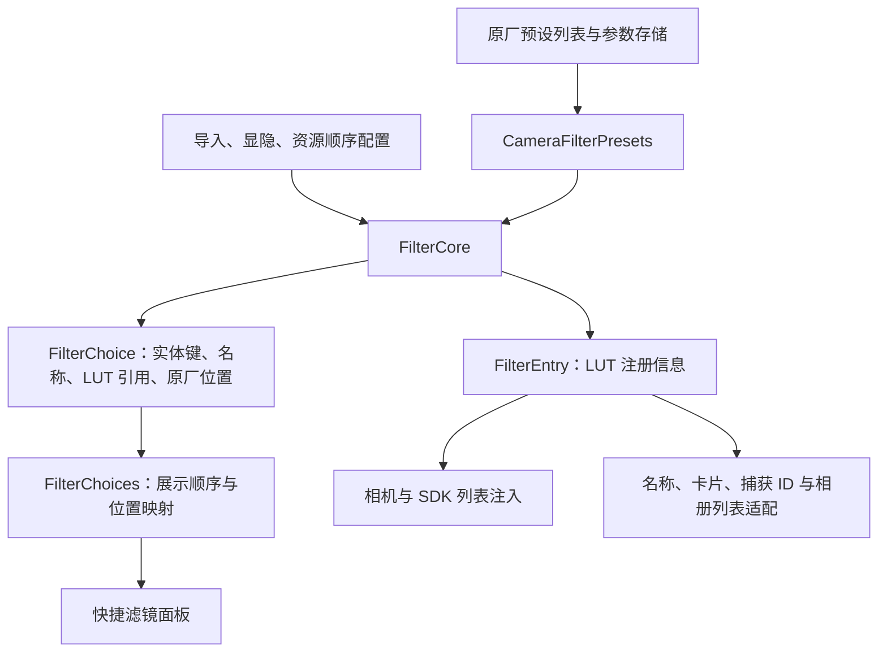
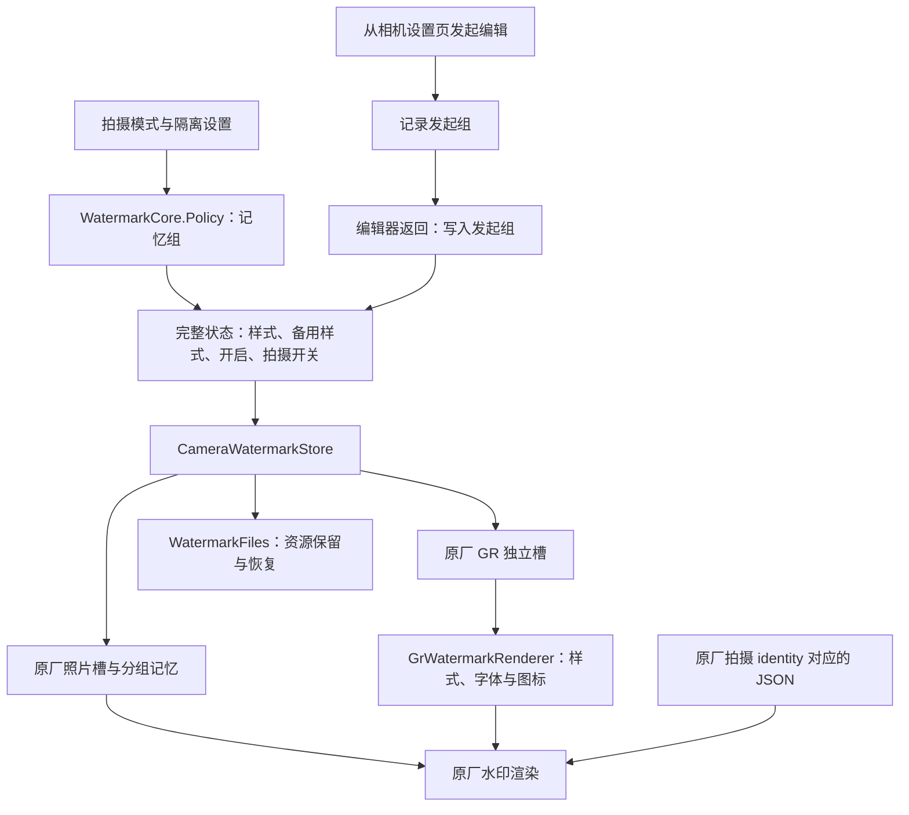

# 滤镜与水印

本文对应 Opus 0.0.1 的滤镜与水印结构。代码位于隔离工作区 `实验/滤镜水印重构/OmniCam-Muse`，分支为 `exp/filter-watermark-core`。

范围包括滤镜资源、原厂预设、导入、显隐、排列、名称、卡片，以及照片水印的状态归属、编辑回传和资源恢复。GR 模式本身与大师色彩引擎分别维护；GR 水印属于本文范围。

## 滤镜实体与资源

原厂滤镜、导入滤镜、已保存的 `custom_N` 都是可选实体。实体使用原厂参数键识别，LUT 类型作为资源引用。多个实体可以共用一份 LUT，同时保留各自的原厂调节记忆。

`FilterCore` 持有普通、大师两份资源目录与当前配置。设置页、组注入、名称、卡片、捕获 ID 和相册都读取这份定义。大师列表的可见顺序由 `MasterLayout` 计算：隐藏资源留在底层尾部，预设继续保留引用；普通模式跟随大师时由 `NormalMasterMirror` 处理对应的普通版资源。相册追加默认开启且可访问的资源，保留原厂索引。

设置页“大师滤镜”按实体列出：相机上报自定义预设（`custom_N`、预设名、所用 LUT 类型）与布局后的滤镜列表，`MasterFilterStore` 把预设作为“我的预设”与原厂、导入滤镜一起排序和显隐。相机不再报告的 `custom_N` 的排序与显隐记录随即删除，复用该槽位的新预设从默认状态开始。相机滤镜条用同一份布局排列 `FilterChoices`，隐藏的预设不出现在滤镜条上。

`FilterChoice` 的实体键与 LUT 类型分开。例如内置电影滤镜、`custom_0` 与 `custom_1` 可以引用同一电影 LUT，三者各自使用原厂参数键。`FilterChoices` 按实体键排列并记录展示位置到原厂位置的双向映射，快捷面板通过这个映射选中原厂预设。原厂内部仍按自定义预设在前、内置滤镜在后的顺序管理。

原厂 `PresetDataRepository` 持有自定义预设的实体、当前记忆值与保存基准。日常调节更新当前值，另存建立新实体，保存修改更新基准，重置恢复基准。`custom_base_N`、原厂 JSON 和相关偏好均由原厂流程维护。模块的对比度与颗粒（强度、大小）按所选预设或滤镜记忆，沿用原厂作用域与基准（`ModuleEffects`），另存、保存修改、重置和“已修改”判断都计入这些值，各自保持参数范围。

Pro 手动拍摄参数的记录预埋保留在 `MasterPreset.ProParams`、`ProParamsRecord` 与 `MasterProPresets`。它面向 ISO、快门、白平衡、对焦等手动参数；入口保持未启用。滤镜核心继续接入当前运行中的原厂效果参数机制。

删除导入资源时，`MasterFilterSync` 提交被删类型，`MasterPresetListSync` 通过原厂删除接口清理关联预设。列表补建与选择恢复沿用原厂预设键及 `PresetSelection`。显示资源的隐藏状态不等于删除实体。

## 原厂接口适配

| 适配 | 职责 |
| --- | --- |
| `FilterGroupInjector` | 相机与 SDK 的滤镜组、隐藏尾部、预设匹配、显示数量 |
| `CameraFilterPresets` | 读取原厂预设对象，提供实体投影与原厂位置 |
| `FilterCards` | 现有卡片布局、类别标签、标题宽度 |
| `FilterLabels` | 列表和成片的滤镜名称，精确写入预设滤镜名字段 |
| `CaptureIds` | 将 LUT 类型映射到原厂捕获枚举 |
| `GalleryFilters` | 相册可访问资源的列表追加 |
| `MasterPresetListSync` | 预设列表完整性、删除关联与选择恢复 |

名称资源、捕获枚举与业务身份分别表达。部分模块 LUT 通过 Radiance 的资源和枚举进入原厂管线，LUT 类型仍指向各自的文件。`FilterLabels` 只修改原厂预设的滤镜名称字段，实体名称、实体键与参数不参与文字替换。

X10 的调色盘与枚举、霓虹光晕、Portra 光晕、颗粒、滤镜高规格视频及高像素能力仍有专用适配。GR 模式实现与大师色彩引擎各自独立。

## 水印的记忆与归属

每个组保存完整状态，空样式和关闭开关均为有效记忆；“从未选择”和“主动关闭”分别表达。GR 照片固定使用独立组；“独立保存水印”页里开启的拍照模式（`ModuleSettings.WATERMARK_MODES`，候选为 `LaunchModes.WATERMARK_NAMES`）各自成组；XPAN 由“XPAN 水印隔离”加入同一机制；其余模式共用普通照片组。策略接受任意拍照模式名，模式记忆不依赖样式属于哈苏、LUMO 还是理光。照片和视频在策略中分别表达；当前视频继续使用原厂的视频通道。

GR 使用原厂限定模式的物理槽，普通照片组与 XPAN 通过同一个照片槽切换。`CameraWatermarkStore` 保存槽的归属和各组记忆；首次进入尚无设置的独立组时沿用当前选择。`WatermarkFiles` 保留样式与备用样式的文件，避免原厂清理当前目录时丢掉其他组的资源。

编辑相机默认水印时，`WatermarkHooks` 在打开编辑器（`Util.openEditor` 或启动 `PhotoEditorActivity`）处记录发起组；该记录只对这一次编辑请求有效：结果提交后清除，取消编辑则在相机回到前台 15 秒后失效，之后的回传按当前拍摄模式所属组处理。原厂 Binder 的 `sendResData`、`sendResData2` 与广播回传共用编辑上下文，照片四项状态在回传完成后一起落到发起组。广播的资源拷贝任务携带同一上下文，在拷贝结束后保留返回样式的资源，并恢复当前照片槽所需的资源。返回时切换了拍摄模式，当前照片槽仍属于当前组；返回结果留在发起组。GR 与普通照片之间的联动写入和键删除使用同一分区规则。

槽归属与分组记忆写入相机数据存储；编辑器发起组属于相机进程内的单次请求状态。模式切换时，槽按目标组换入换出，不按“该模式是否仍独立”改写槽归属。Binder 回传在原厂方法返回后提交状态与资源；广播回传先提交状态，由原厂异步拷贝任务完成资源保留和当前组资源恢复。

实时样式加载按请求模式选择该组状态，修正原厂缓存中的其他组样式。原厂已经按拍摄 identity 保存的延迟处理 JSON 直接交回原厂流程，后续切换模式或样式不改写这份 JSON。XPAN 实况的画面几何与合成继续由 `XpanLivePhoto` 处理。

相册中的现有照片编辑有独立的样式选择与保存过程。`GrGalleryWatermark` 提供理光样式、图标和 GR 信息适配，`WatermarkSeriesUnlock` 开放系列，`WatermarkFilterNames` 使用照片内保存的滤镜名称；批量编辑由 `BatchWatermark` 驱动原厂编辑器。它们不以当前相机模式重新解释照片归属。

## 代码入口

以下路径相对于仓库根目录：

| 路径 | 内容 |
| --- | --- |
| [`app/src/main/java/local/jiege/hook/ModuleEntry.java`](../app/src/main/java/local/jiege/hook/ModuleEntry.java) | 相机与相册的功能安装入口 |
| [`hook/filters/`](../app/src/main/java/local/jiege/hook/filters/) | 滤镜核心、资源定义、排列、预设投影、卡片与名称适配 |
| [`hook/masterfilter/MasterPresetListSync.java`](../app/src/main/java/local/jiege/hook/masterfilter/MasterPresetListSync.java) | 原厂预设列表、删除关联与选择恢复 |
| [`settings/MasterFilterStore.java`](../app/src/main/java/local/jiege/settings/MasterFilterStore.java) | 设置页的导入、显隐、排序、备份和恢复 |
| [`lut/Rec709LutBaker.java`](../app/src/main/java/local/jiege/lut/Rec709LutBaker.java) | 导入 LUT 的解析、连续数组存储与烘焙 |
| [`hook/watermark/`](../app/src/main/java/local/jiege/hook/watermark/) | 水印分组、存储、回传、资源与渲染适配 |
| [`app/src/main/assets/symbols.json`](../app/src/main/assets/symbols.json) | 原厂方法与字段的识别定义 |

原厂接口定位中，`Preset.filterName` 对应预设的滤镜名称字段；`WatermarkEditor.receive` 对应设置页的广播接收方法；`WatermarkEditor.copy` 对应广播资源拷贝任务。水印回传与资源拷贝的业务衔接集中在 `WatermarkHooks`。

## 构建与独立校验

[`build.ps1`](../build.ps1) 负责 Gradle 发布构建与模块打包。离线测试由 [`tools/offline_tests/run.ps1`](../tools/offline_tests/run.ps1) 独立运行，色彩目录检查由 [`tools/mastercolor/check_catalog.py`](../tools/mastercolor/check_catalog.py) 独立运行，Shell 语法检查按需单独执行。

设备侧待确认事项集中列在 [README 的“未验证”一节](../README.md#未验证)。

## 下一步

- 视频沿原厂独立通道工作。若开放视频模式之间的独立设置，需要补齐对应的资源目录与存储适配。
- 启用 Pro 手动参数记录时，沿用 `MasterPreset.ProParams`、`ProParamsRecord` 和 `MasterProPresets` 的预埋，对接原厂预设的选择、保存、重置与删除生命周期。
